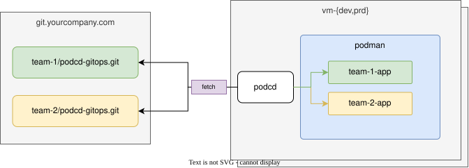

## Fetch

- The repository in `agent.yaml` is fetched at its defined `revision` (branch, tag or commit). 
  - If the remote is unreachable but a checkout exists, the agent reconciles from that commit and reports the repository as offline.
- Every manifest is read into one index;
  - You cannot name define a name twice, this is considered an error. The index is compiled for the host the agent is configured for  (default: the hostname). See the [configuration model](configuration/model.md) and [values templating](configuration/values.md).

## Plan & reconcile

Desired and actual are compared per application declared for a `Host`:

- if not on the host -> **create**
- if rendered/played unit differs from disk -> **update**
- if unchanged, but the unit is not active -> **restart**
- if on host but no longer in Git -> **delete** (when `prune` is on, the default; otherwise a no-op)

[Networks](configuration/networks.md) go through the same comparison. Deletes run before creates, so a renamed application frees its host port before its successor binds it.

Reconciles run one at a time under a file lock, so `podcd reconcile` and the agent's loop never fight.
Destructive actions are logged before they happen and the first failure stops the run and recorded.

A failed reconcile is retried after `retryInterval`, doubling up to `maxRetryInterval`; after a success the regular `interval` resumes. `jitter` adds a random delay to `interval` so a fleet does not hit Git in lockstep.

Images no container uses are removed (internal with `podman image prune --all`) every `imagePrune` (off by default; e.g. `24h`) after a successful reconcile.

## State

`~/.local/state/podcd/state.json` records the host identity, last revisions, last success and failure, and per-application history.
`podcd status` reads this state so it works offline, this is metadata only and is safe to delete.

Everything the agent owns is under its user's home:

```text
~/.config/podcd/agent.yaml          agent config
~/.config/podcd/agent.env           secrets
~/.config/containers/systemd/       Quadlet units podcd wrote
~/.local/state/podcd/               checkouts, played manifests, state.json
```

## Metrics

With `metricsAddress` set (e.g. `127.0.0.1:9464`), the agent serves `GET /metrics` in the Prometheus text format, rendered from `state.json` on every scrape:

| Metric | Meaning |
|---|---|
| `podcd_info{version,host}` | Always 1; the agent's version and host. |
| `podcd_last_attempt_timestamp_seconds` | When the last reconcile started, successful or not. |
| `podcd_last_success_timestamp_seconds` | When the last successful reconcile started. |
| `podcd_consecutive_failures` | Reconciles failed since the last success. |
| `podcd_repository_offline{repository}` | 1 if the last reconcile used the commit on disk because the remote was unreachable. |
| `podcd_application_healthy{application}` | 1 if the application's last health check passed. |

A port that cannot be bound is logged and the agent keeps reconciling. To scrape a loopback address from a container, e.g. Grafana Alloy deployed by podcd, give its pod `hostNetwork: true`:

```alloy
prometheus.scrape "podcd" {
  targets    = [{"__address__" = "127.0.0.1:9464"}]
  forward_to = [prometheus.remote_write.default.receiver] // or otelcol.receiver.prometheus for OTLP
}
```

Useful alerts: `time() - podcd_last_success_timestamp_seconds > 900` (the agent is stuck, failing or gone), `podcd_consecutive_failures > 3`, `podcd_application_healthy == 0`, and `podcd_repository_offline == 1` for longer than an outage you tolerate.
